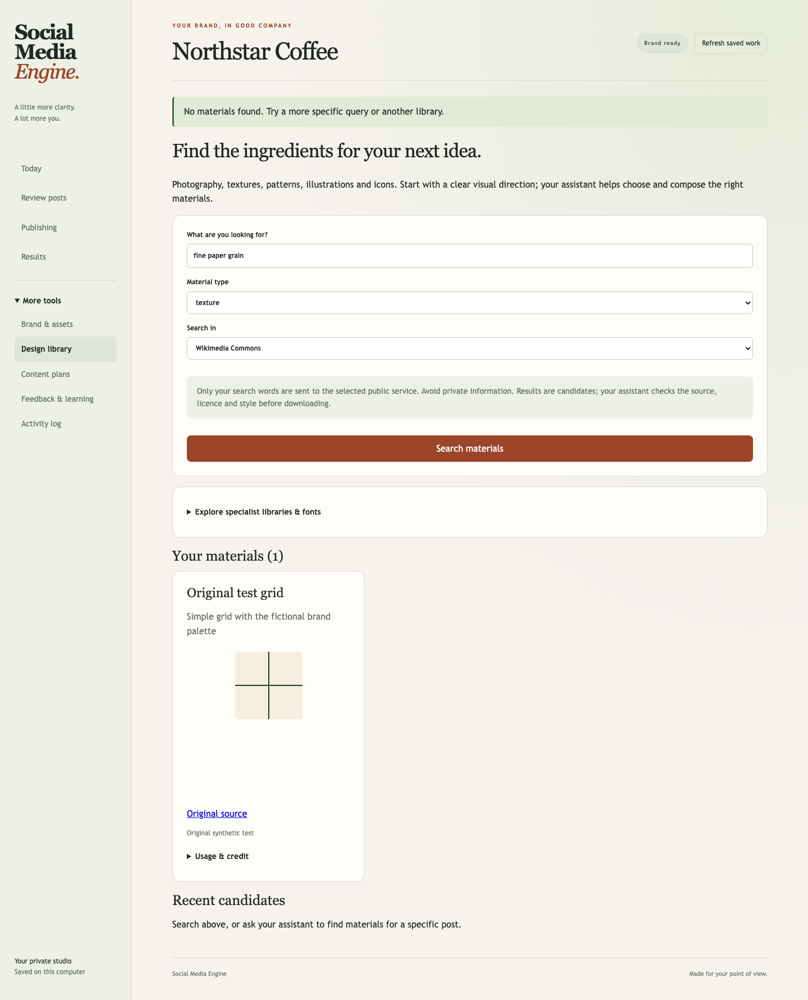
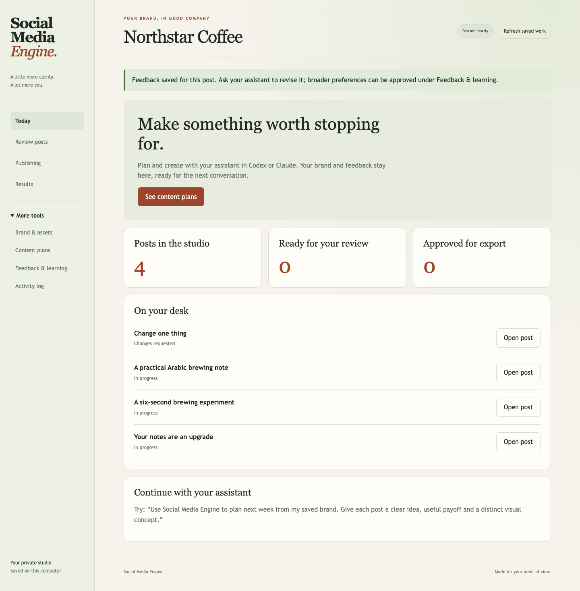

<div align="center">

# Social Media Engine
### Everything social media, in one plugin.

**A brand-first social media teammate for Codex and Claude.**

[Getting started](#getting-started) · [What it does](#what-it-does) · [Workflow](#your-first-session) · [Safety](#safety-and-privacy) · [Contributing](CONTRIBUTING.md)

**English** | [العربية](README.ar.md) | [日本語](README.ja.md)

</div>

---

## Built for small teams with serious standards

For independent businesses, solo operators, creators, and small teams managing social
media at a medium scale. Start with your brand, not a generic content template.

Social Media Engine uses the model and creative tools available in your AI host.
It combines guided onboarding, persistent brand memory, deliberate creative direction,
platform-aware writing, review, and controlled delivery.

> **Version 2:** a local-first agent plugin, not a hosted SaaS app or an autonomous
> posting bot. Planning and copy use your host's model. Actual media requires available
> generation/rendering tools. Publishing and account data require your own integrations.

## New in version 2.2: a creative memory for every brand

A familiar brand benefits from months of context and feedback. New brands need that
context made explicit. The plugin now develops and saves an **owner-approved creative
brief**: the audience's situation, supported promise, proof, voice examples, visual
principles, content pillars, anti-patterns and success criteria.

- Compare the brand's actual existing work, identify what should improve, and develop
  distinct ideas before choosing a style. Avoid interchangeable layouts and repetitive CTAs.
- Review 1–3 actual samples and save their approved direction. Each brand keeps its own
  brief and sample references; future sessions reload the current approved version.
- Profile, approved feedback or sample changes make affected creative memory stale.
  New proposals stay inactive until explicitly approved. Existing workspaces remain usable.
- **Today → Brand & assets** shows creative readiness and the approved brief.

The release includes original, attributed [research findings](plugins/social-media-engine/skills/social-media-engine/references/research-findings.md)
from **123 complete qualifying Canva templates / 302 inspected pages**, with 31 excluded
style candidates and 2 partial items. Research stopped at the owner's request before the
1,000-per-style targets; no videos qualified. The notes distinguish observations from
interpretations and unstudied styles. Canva artwork and private customer content are not bundled.

This adds a repeatable process for new brands; it does not guarantee identical creative
quality across models or brands. Actual outputs and owner feedback remain the test.
See the [brand-quality workflow](plugins/social-media-engine/skills/social-media-engine/references/brand-quality.md).

## New in version 2.1: real design materials

Find and use real photography, icons, illustrations, textures, patterns and fonts as part
of an original composition. The assistant starts with the post's visual direction,
compares actual materials and records why the selected ones fit your brand.

- **Search in the studio:** Openverse, Wikimedia Commons, Iconify and the Met Open Access.
- **Explore specialist libraries:** ambientCG, Poly Haven, Hero Patterns, unDraw, SVG Repo,
  Pexels, Unsplash and Google Fonts, plus other sources through the host's web/browser tools.
- **Download and reuse:** reviewed public HTTPS files or explicit manual imports go into
  a separate brand-specific Design library. Adding materials keeps brand approval intact.
- **Keep source records:** creator, licence evidence, intended use and edits follow each
  post. Required attribution stays in captions; exports include credits and provenance.

The four built-in searches need no API key. Other libraries use the host's browser/tools;
paid downloads require your own authorization and licence. Search results need actual
source and licence inspection. The runtime records that inspection; it does not certify
legal clearance or generate a finished composition on its own. Current material formats:
PNG, JPEG, WebP, static SVG and TTF/OTF/WOFF/WOFF2; maximum 20 MB (SVG 2 MB).

Try: **"Find real photography and subtle textures that match this post's direction.
Use them in an editable composition, keep source credits, and show me the finished design."**



See the [sourcing workflow](plugins/social-media-engine/skills/social-media-engine/references/resource-sourcing.md).

## Brand studio foundations

- **Start with what you have.** Bring a complete identity, a few references, or no brand
  assets at all. A short conversation develops the missing pieces.
- **Choose a direction.** Compare 2–4 saved proposals, see palette swatches and tradeoffs,
  then choose one. Rendered sample designs help calibrate before a full batch.
- **More thoughtful content.** Research the audience situation, develop a useful argument,
  show evidence, and vary composition and pacing without losing brand recognition.
- **A simpler studio.** Today, Review posts, Publishing, Results. Review one post at a
  time, move through its slides, switch platform captions, and leave specific feedback.
- **Memory that stays yours.** Keep brand-specific choices and approved preferences;
  changing identity makes affected approvals stale.

The package is brand-neutral: it does not ship the creator's private brand assets,
customer data, fonts, accounts or fixed visual style. It uses your host's model and tools.

## What it does

| Stage | Included |
| :--- | :--- |
| **Understand your brand** | Resumable questionnaire, guidelines, assets, voice, audience, goals and owner approval |
| **Remember** | Separate brand profiles, source/rights notes, scoped feedback and persistent approved rules |
| **Plan** | Monthly strategies, content pillars, briefs, dates and timezone-aware calendar records |
| **Source** | Public-library search, specialist web discovery, reviewed downloads and reusable brand materials |
| **Create** | Agent workflows for platform-specific copy, images, carousels and video |
| **Review** | Local dashboard, actual asset previews, revision history, review records and owner approval |
| **Deliver** | Approved manual exports; optional Postiz account discovery, uploads and dispatch |
| **Learn** | Evidence-backed metric snapshots, reporting workflow and approved feedback rules |

### Platform support, without inflated promises

Instagram, Facebook and TikTok are primary workflow targets. Planning and manual delivery
can be adapted to other networks. Automated posting depends on a connected Postiz
integration, its current format support, account eligibility and provider settings.

A connected account does not guarantee every format or permission. TikTok upload mode
may require completion in TikTok. Analytics and inbox access vary by platform.
The bundled runtime is **not** a universal OAuth service or unified social inbox.

## Getting started

### 1. Requirements

- Codex or Claude with plugins/skills, local execution and access to a working folder.
- Python **3.10+**, with an IANA timezone database. Windows installations without one can
  install `tzdata`: `python -m pip install tzdata`.
- A private folder for content and memory. Brand files and references are optional.
- Optional: image/video/design tools and your own Postiz cloud or self-hosted account.

There is no required OpenAI API key, bundled model subscription, model credit, or
mandatory paid creative service. Host subscriptions and third-party services are separate.

### 2. Install in your host

<details open>
<summary><strong>Codex</strong></summary>

This repository includes a Codex marketplace at `.agents/plugins/marketplace.json`
and a native plugin manifest inside `plugins/social-media-engine/.codex-plugin/`.

Use your Codex installation's plugin/marketplace management to add this repository:

```text
AurendorAi/social-media-engine
```

Select **Social Media Engine** and install/enable it. For workspace-managed installations,
an administrator may need to import or allow the GitHub marketplace first.
Host availability and installation UI depend on the current account/app.
See [OpenAI's plugin packaging and marketplace documentation](https://developers.openai.com/plugins/build/plugins).
For Codex CLI versions with plugin support:

```sh
codex plugin marketplace add AurendorAi/social-media-engine
codex plugin add social-media-engine@social-media-engine
```

Ask Codex to use **Social Media Engine**. See the [tested host compatibility notes](docs/HOST-COMPATIBILITY.md).

For a local checkout, point the host's local marketplace loader at the repository root.
The plugin source itself is `plugins/social-media-engine`, not the old application.

</details>

<details>
<summary><strong>Claude Code</strong></summary>

```text
/plugin marketplace add AurendorAi/social-media-engine
/plugin install social-media-engine@social-media-engine
```

Invoke `/social-media-engine:social-media-engine` or ask Claude to use the plugin.
For local development:

```sh
claude --plugin-dir ./plugins/social-media-engine
```

See [Claude's plugin documentation](https://code.claude.com/docs/en/plugins).

</details>

<details>
<summary><strong>Claude Cowork</strong></summary>

Use Cowork's plugin customization/add-plugin flow where supported by your account.
Add this GitHub marketplace if that option is available, or upload the plugin ZIP from
the project's releases. The ZIP must contain the plugin's `.claude-plugin/`, `skills/`,
`scripts/`, and `assets/` at its root, not the entire GitHub source archive.

Give Cowork access to the intended working folder. Its execution environment must have
Python and a writable local workspace. If the host does not support a loopback browser
preview, review exported files in the host instead of claiming the dashboard opened.

</details>

<details>
<summary><strong>Other AI assistants</strong></summary>

Use the release ZIP as a portable skill/runtime folder if your assistant can read local
Markdown, run Python and access your chosen workspace. Keep `skills/`, `scripts/` and
`assets/` together, and point the assistant to `skills/social-media-engine/SKILL.md`.
Native installation and creative tools depend on that host. A chat-only service cannot
run the local dashboard or persist the workspace by itself.

</details>

### 3. Start your brand workspace

```text
Use Social Media Engine to set up my brand.
My working folder is [your private folder].
I may have brand files or references, or I may be starting from scratch.
Ask only the missing questions, help me find a direction,
and get my approval before creating content.
```

The skill asks only relevant missing questions and saves each group. You do not need
to fill in a giant JSON file. Use a different brand ID for each brand.

## Your first session

```text
Existing identity / optional references / guided discovery
             |
     Chosen visual direction
             |
       Approved brand brief
             |
     Strategy + monthly plan
             |
 Small calibration sample + feedback
             |
   Platform copy + actual media
             |
 Independent review + revisions
             |
        Owner approval
             |
     Export or confirmed send
             |
    Real evidence + feedback
```

1. **Describe the business.** Offers, audience, markets, languages, goals and constraints.
2. **Bring the identity.** Guidelines, logos, fonts, examples, voice and styles to avoid.
3. **Approve the brief.** Review what the plugin learned before production begins.
4. **Choose the tools.** Manual delivery is available without Postiz. Connect optional
   creative/social services through their authorized flows, never by sharing passwords.
5. **Calibrate quality.** Ask for 1-3 samples in your planned formats, including motion only when tools
   permit. Review the actual files and give specific feedback.
6. **Build a repeatable workflow.** Approve useful scoped rules, revise a sample, then
   move into monthly production.

### Useful prompts

| You want to… | Ask… |
| :--- | :--- |
| Start a calendar | "Plan next month around our goals and team capacity. Explain the strategy first." |
| Produce a carousel | "Turn this idea into an on-brand Instagram carousel and a distinct Facebook variant." |
| Make a video | "Create a short video with a script, storyboard, actual render and full playback review." |
| Open review | "Open my Social Media Engine dashboard and show what needs approval." |
| Improve the voice | "Propose this as a permanent LinkedIn rule: no hype or exaggerated claims." |
| Deliver safely | "Export the approved assets and captions for manual posting." |
| Schedule | "Prepare these approved posts for my selected accounts. Show the exact schedule before sending." |
| Learn | "Analyze these real performance exports, flag unavailable metrics, and suggest next month's experiments." |

## Review dashboard



*Fictional test brand. This preview shows the interface, not a creative-quality benchmark.*


Ask the agent to open it, or run:

```sh
python3 plugins/social-media-engine/scripts/sme.py \
  --workspace "/absolute/path/to/your/working-folder" \
  --brand your-brand dashboard
```

Open the printed private URL on the same machine and leave the command running.
Use Ctrl+C to stop. The dashboard provides brand onboarding, asset import, calendar
records, content/media review, feedback, approvals, exports, and publishing evidence.

It binds to **127.0.0.1**, uses a random session token, and is intended for one trusted
owner. Do not expose it publicly, put it behind a public tunnel, or treat it as an
authenticated multi-user service.

## Optional Postiz publishing

Set credentials privately in your shell or host environment:

```text
POSTIZ_API_URL=https://your-postiz-instance.example/api/public/v1
POSTIZ_API_KEY=your-private-key
```

Use the exact public API base URL for your deployment, including any proxy prefix.
The example is illustrative, not automatic endpoint discovery.
The plugin does not automatically load `.env` files. Do not paste real credentials into
chat, commit them, or use the values shown above as working credentials.

The agent reads actual accounts, prepares an exact intent, and asks for confirmation.
Sending additionally requires `--send` and `SOCIAL_ENGINE_ALLOW_PUBLISH=true`.
Even creating a remote draft is an external write.

**A submitted request is not a published post.** Ambiguous outcomes are blocked from
blind retries. Check the provider and reconcile actual post IDs/status. Editing or
cancelling an already-submitted schedule happens through Postiz or the native provider;
local cancellation does not remove a remote post.

See the [publishing guide](plugins/social-media-engine/skills/social-media-engine/references/publishing.md)
and [command contracts](plugins/social-media-engine/skills/social-media-engine/references/runtime.md).

## Upgrade from version 1

Back up the private workspace while commands and the dashboard are stopped, then update
or reinstall the plugin in your host and reopen the same workspace and brand ID.
The existing SQLite schema, profiles, items, feedback and approval records are retained.
Existing approved profiles do not need the new optional discovery fields. Selecting a
new visual direction is an identity change and requires a fresh brand review.

## Safety and privacy

- Memory and imported assets stay in `.social-media-engine/` under your working folder.
- Each command selects an explicit workspace and brand. No shared default brand identity.
- Identity/rule/content changes invalidate affected approvals. Media bytes are hash-checked.
- Credentials are environment-only. No telemetry or automatic network calls on install.
- External creative/social tools receive selected content only through authorized use.
- Private state is not encrypted by this plugin. Use device security and trusted folders.
- Never commit workspace data. Add `.social-media-engine/` to your workspace's ignore rules.
- Back up the whole state folder while the dashboard/CLI is stopped. Restore it into a
  private working folder; do not merge two SQLite databases by copying individual files.

See [privacy](PRIVACY.md) and [security](SECURITY.md).

## Deployment and limitations

The MIT licence permits adapting the source for local, team, self-hosted or hosted use.
The supported runtime is **local, single-owner**. Hosted/multi-user deployments need
their own authentication, authorization, encrypted secret storage, isolation, backup
and operational design. Open source does not mean those protections are already built.

Professional output depends on your approved brand context, host model, creative tools
and honest review. The plugin supplies a disciplined process, not a promise that every
model or every first draft will match an existing brand's best work.
Automated tests verify workflow behavior, not creative taste or live platform approval.

No live social-account certification is bundled. Test your own integrations with safe
accounts before relying on production scheduling.

## Development and release

```sh
python3 -m unittest discover -s tests -v
python3 scripts/build_release.py
```

Release artifacts are written to `dist/` with SHA-256 checksums. The builder packages
only the plugin, rejects unsafe/symlink paths and excludes private workspaces, caches,
legacy files and customer assets. GitHub source archives are not plugin installation ZIPs.

Optional dashboard browser testing uses Playwright; see [testing](docs/TESTING.md).
For architecture and implementation scope, see [architecture](docs/ARCHITECTURE.md).

## Contributing and support

Issues and pull requests are welcome. See [contributing](CONTRIBUTING.md).
Report security issues privately using [SECURITY.md](SECURITY.md).
A screen-recorded walkthrough will be linked when available.

**Built by [Aurendor](https://www.instagram.com/aurendor/).**
Contact: [mohammedj@aurendor.io](mailto:mohammedj@aurendor.io).
Released under the [MIT licence](LICENSE).
